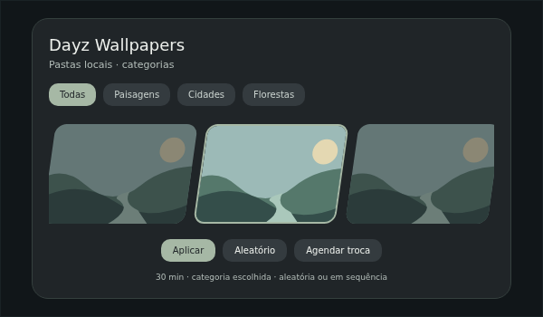

# Dayz Wallpapers

Seletor de wallpapers para **DankMaterialShell 1.4.6+**: carrossel inclinado,
categorias por pasta e troca automática aleatória ou em sequência.
Código original de Matheuscara, desenvolvido com ajuda de IA (Codex). Licença MIT.



## Instalar no Nix — um comando

Com Nix e DMS já instalados, execute como seu usuário, **sem sudo**:

```bash
nix run github:Matheuscara/dayzWallpapers
```

O instalador inclui Python, instala o plugin no diretório do usuário e tenta
habilitá-lo no DMS em execução. Não precisa clonar o repositório, instalar Python
manualmente ou fazer rebuild do NixOS. Mantém uma raiz de garbage collection em
`~/.local/state/dayzWallpapers/current` para o plugin e Python continuarem presentes
após `nix-collect-garbage`. Respeita `XDG_CONFIG_HOME` e `XDG_STATE_HOME`.

Para conferir sem instalar:

```bash
nix run github:Matheuscara/dayzWallpapers -- --dry-run
```

Para atualizar/substituir uma instalação existente, guardando backup:

```bash
nix run --refresh github:Matheuscara/dayzWallpapers -- --replace
```

O backup fica em `~/.config/DankMaterialShell/backups/`. Configurações pessoais são
preservadas. Atualizações de QML podem exigir reiniciar o DMS; o instalador não
reinicia sua sessão. Se o DMS estiver fechado, abra-o e habilite **Wallpapers**
em Configurações → Plugins. `--no-enable` instala sem tentar habilitar.

Se Nix reclamar de recursos experimentais, use o prefixo
`nix --extra-experimental-features 'nix-command flakes' run ...`.
Este projeto instala um plugin; a instalação do DMS/compositor é pré-requisito.

## Abrir e configurar

```bash
dms ipc call dayzWallpapers toggle
```

Em Configurações → Plugins → Wallpapers, escolha sua pasta. Por padrão usa
`~/Pictures/Wallpapers`. Cada subpasta vira uma categoria. O download de wallpapers
não faz parte do instalador; imagens e configurações pessoais não são distribuídas.

**Agendar troca** permite escolher categoria, ordem e intervalo de 1 a 1440 minutos.
A programação começa **desligada** e continua funcionando com o seletor fechado,
enquanto o DMS estiver aberto. Ao ativar, pausa o temporizador nativo do DMS para
evitar duas trocas concorrentes.

Exemplo de atalho Niri, dentro de `binds`:

```kdl
Mod+Ctrl+W { spawn "dms" "ipc" "call" "dayzWallpapers" "toggle"; }
```

[Detalhes de uso e IPC](plugin/README.md).

## NixOS declarativo

Adicione o input ao seu flake:

```nix
inputs.dayzWallpapers.url = "github:Matheuscara/dayzWallpapers";
```

Inclua `inputs.dayzWallpapers.nixosModules.default` em `modules`, junto do módulo
NixOS do DMS que fornece `programs.dms-shell.plugins`. Depois faça seu rebuild
normal e habilite o plugin pela interface do DMS. Python já está incluído no pacote.
O módulo não instala nem habilita o DMS por conta própria.

Para Home Manager, importe `inputs.dayzWallpapers.homeManagerModules.default`.
Ele instala a mesma versão empacotada via `xdg.configFile`.

Escolha **uma** forma de instalação por máquina. Antes de migrar do instalador
para um módulo, desabilite o plugin, guarde/remova somente o link de instalação
manual `~/.config/DankMaterialShell/plugins/DayzWallpapers` e depois aplique o módulo.
As preferências do DMS ficam em outro arquivo e são preservadas. Não importe também
o módulo da coleção dayzWidgets contendo o mesmo plugin.

## Sem Nix

```bash
git clone https://github.com/Matheuscara/dayzWallpapers.git
cd dayzWallpapers
python3 scripts/install.py
```

Nesse modo, mantenha o checkout no disco e Python 3 disponível no PATH do DMS.
O código de interface em `plugin/` é o mesmo publicado na
[coleção dayzWidgets](https://github.com/Matheuscara/dayzWidgets).

## Remover

Desabilite o plugin na interface do DMS. Remova somente o link
`~/.config/DankMaterialShell/plugins/DayzWallpapers` e a raiz
`~/.local/state/dayzWallpapers/current` criados pelo instalador. Backups e
configurações pessoais podem ser mantidos. Se usou um módulo, retire sua importação
e aplique novamente o NixOS/Home Manager.

## Verificar o projeto

```bash
python3 -m unittest discover -s tests -v
nix build .#plugin
nix flake check
```
